# OnderCode Suite

.NET 10 + WinForms ve Blazor ile yazılmış, açık kaynak, uçtan uca çalışan otomasyon uygulamaları ve onların ortak altyapısı.
Kurulum gerektirmez: SQL Server yok, bağlantı ayarı yok. Uygulama ilk açılışta veritabanını oluşturur, migration'ları uygular ve örnek veriyi yükler.

**Lisans:** MIT. Ücretli ya da gelir sınırlı lisans isteyen hiçbir paket kullanılmaz.

## Çözüm yapısı

```
OnderCode.Suite/
├─ src/
│  ├─ Shared/
│  │  ├─ OnderCode.Kernel        Bağımlılıksız çekirdek: Entity tabanları, Specification,
│  │  │                          IRepository / IUnitOfWork sözleşmeleri, Türkçe metin yardımcıları
│  │  ├─ OnderCode.Data          EF Core + SQLite: SuiteDbContext, Repository, UnitOfWork,
│  │  │                          denetim, yumuşak silme, Türkçe sıralama/arama, başlatıcı
│  │  ├─ OnderCode.Application   Komut/sorgu dağıtıcı, davranış hattı (log, hata çevirisi,
│  │                          FluentValidation), Result türü, alan olayı dağıtıcısı
│  │  ├─ OnderCode.Analytics     Bağımlılıksız analiz: Pareto/ABC, doğrusal trend, Holt, Holt-Winters
│  │  ├─ OnderCode.Reporting     Rapor modeli; Excel (kendi yazıcımız), PDF (PDFsharp), CSV
│  │  └─ OnderCode.WinForms      Uygulamaların ortak arayüz parçaları: sayfa tabanı, rapor kaydetme, ekran görüntüsü
│  └─ Apps/                      her uygulama 4 katman: Domain · Application · Infrastructure · arayüz (WinForms / Web)
│     ├─ Otel/                     OnderCode Otel ✔ hazır
│     ├─ Otopark/                  OnderCode Otopark ✔ hazır (otopark + araç yıkama)
│     ├─ Eczane/                   OnderCode Eczane ✔ hazır (eczane ERP: satış, stok, depo, personel, nöbet, demirbaş)
│     ├─ Sinema/                   OnderCode Sinema ✔ hazır (web: salon tasarımı, seans, gişe, online bilet, QR, kapı, büfe)
│     ├─ Donanim/                  OnderCode Donanım ✔ hazır (bilgisayarın donanım karnesi: RAM yuvaları, disk, pil, öneriler)
│     ├─ SiteYonetimi/             OnderCode Site Yönetimi
│     ├─ Lojistik/                 OnderCode Lojistik
│     └─ Personel/                 OnderCode Personel
└─ tests/
   ├─ OnderCode.Data.Tests          Gerçek SQLite dosyası üzerinde veri katmanı testleri
   ├─ OnderCode.Application.Tests   Dağıtıcı + hat + veri katmanı birlikte, uçtan uca
   ├─ OnderCode.Reporting.Tests     Pareto ve tahmin doğruluğu; Excel/PDF/CSV çıktılarının yapısı
   ├─ Otel.Tests                    Fiyat motoru, çakışma kuralı, KPI hesabı, raporlar, örnek veriyle uçtan uca akış
   ├─ Otopark.Tests                 Tarife motoru, plaka doğrulama, yıkama iş akışı, abonelik, raporlar, uçtan uca gişe akışı
   └─ Eczane.Tests                  Katılım payı, reçete rengi, FEFO, MF, cari yaşlandırma, izin hakkı, nöbet dağıtımı, amortisman, uçtan uca akışlar
```

Bağımlılık yönü tek taraflıdır: `WinForms → Infrastructure → Application → Domain → Kernel`.
Kernel ve Data `net10.0` hedefler (Windows'a bağlı değildir); ileride aynı çekirdek web veya mobil arayüzle de kullanılabilir.

## Veri katmanı neler yapıyor?

| Konu | Yaklaşım |
|---|---|
| Sıfır kurulum | `%LocalAppData%\OnderCode\{Uygulama}\{Uygulama}.db`. Exe'nin yanında `portable` dosyası varsa veritabanı `Data\` klasöründe durur. |
| Şema | Migration varsa `Migrate()`, yoksa (prototip) `EnsureCreated()`. Başlangıç verisi `ISeeder` ile, tekrar çalışmaya dayanıklı. |
| DbContext ömrü | `IDbContextFactory` + kısa ömürlü `IUnitOfWork`. Her işlem kendi bağlamını açar ve kapatır; form boyunca açık kalan bağlamın getirdiği eski veri ve bellek sorunları olmaz. |
| Türkçe | Bütün metin kolonları Türk alfabesine göre sıralanır (Ç, C'den sonra; Iğdır, İzmir'den önce). Eşitlik ve benzersiz indeksler büyük/küçük harf duyarsızdır (`İST` = `ist`). `Search()` Türkçe karakter duyarsız arar (`sanliurfa` → Şanlıurfa) ve bu iş veritabanında yapılır. |
| Para | SQLite'ta decimal tür yok. Tutarlar 4 hane hassasiyetle tam sayı saklanır; toplama, sıralama ve karşılaştırma SQL'de, kuruş kaybı olmadan çalışır. |
| Denetim | `CreatedAt/By`, `UpdatedAt/By` otomatik ve UTC. Zaman `TimeProvider` ile alınır, testte sabitlenebilir. |
| Yumuşak silme | `ISoftDeletable` varlıklarda silme satırı işaretler; sorgular silinenleri kendiliğinden gizler, `WithDeleted()` ile görünür. |
| Eşzamanlılık | Her kayıtta artan `Version`. İki kişi aynı kaydı düzenlerse ikincisi anlaşılır bir uyarı alır. |
| Silme güvenliği | Zincirleme silme varsayılan olarak kapalı. İlişkili kaydı olan satır silinemez; gerçek bütünlerde (sipariş-satır) açıkça açılır. |
| Hatalar | SQLite kısıtlama hataları `DuplicateRecordException`, `ReferenceInUseException`, `ConcurrencyConflictException` gibi kullanıcıya gösterilebilir Türkçe istisnalara çevrilir. |
| Alan olayları | Varlıklar olay biriktirir; kayıt (varsa transaction commit'i) başarıyla bittikten sonra yayınlanır. |
| Performans | WAL modu, `synchronous=NORMAL`, liste sorguları varsayılan olarak izlenmez, ekran listeleri için projeksiyon. |

## Uygulama katmanı

Ekranlar yalnızca `ISender` ile konuşur; iş kuralları işleyicilerde, doğrulama doğrulayıcılarda durur.

| Parça | Görevi |
|---|---|
| `ICommand`, `ICommand<T>`, `IQuery<T>` | Ekranın gönderdiği mesajlar. Yanıt her zaman `Result` / `Result<T>`. |
| `ISender` | Mesajı işleyicisine ulaştırır. İstek türü başına bir kez yansıma, sonra önbellek. Her istek kendi DI kapsamında. |
| Davranış hattı | Dıştan içe: **Log** (süre, uyarı, hata) → **Alan istisnası çevirisi** (bulunamadı, mükerrer, eşzamanlılık → başarısız `Result`) → **Doğrulama** (FluentValidation, Türkçe mesajlar) → işleyici. |
| `Result` | Ekran try/catch yazmaz: `if (!sonuc.IsSuccess) form.HatalariGoster(sonuc.Errors)`. Her hatanın `Field` bilgisi var, ilgili kutu işaretlenebilir. |
| `IDomainEventHandler<T>` | Kayıt başarıyla bitince çalışır (ör. rezervasyon onaylandı → odayı dolu yap). |
| `TurkishRules` | `RuleFor(x => x.Tckn).NotEmpty().Tckn()`, `.Vkn()`, `.Iban()` |
| `PagedQuery<T>` | Liste ekranlarının ortak sorgusu: sayfa, sayfa boyutu, Türkçe arama. |

```csharp
public sealed record MusteriKaydet(string Ad, string Tckn) : ICommand<int>;

public sealed class MusteriKaydetDogrulayici : AbstractValidator<MusteriKaydet>
{
    public MusteriKaydetDogrulayici()
    {
        RuleFor(x => x.Ad).NotEmpty().MaximumLength(100);
        RuleFor(x => x.Tckn).NotEmpty().Tckn();
    }
}

public sealed class MusteriKaydetIsleyici(IUnitOfWorkFactory uow) : ICommandHandler<MusteriKaydet, int>
{
    public async Task<Result<int>> HandleAsync(MusteriKaydet komut, CancellationToken ct)
    {
        await using var u = uow.Create();
        var musteri = new Musteri(komut.Ad, komut.Tckn);
        u.Repository<Musteri>().Add(musteri);
        await u.SaveChangesAsync(ct);
        return musteri.Id;
    }
}

// Ekranda
var sonuc = await sender.SendAsync(new MusteriKaydet(adKutusu.Text, tcknKutusu.Text));
```

## Veri katmanı kullanımı

```csharp
// Bağlam: yalnızca DbSet'ler. Aynı derlemedeki IEntityTypeConfiguration sınıfları otomatik uygulanır.
public sealed class OtelDbContext(DbContextOptions<OtelDbContext> options) : SuiteDbContext(options)
{
    public DbSet<Oda> Odalar { get; set; } = null!;
}

// Açılış
services.AddSuiteData<OtelDbContext>(o => o.AppName = "Otel")
        .AddSeeder<OtelDbContext, OdaSeeder>();
await provider.GetRequiredService<DatabaseInitializer<OtelDbContext>>().InitializeAsync();

// Okuma: Türkçe arama + sıralama + sayfalama, hepsi SQL'de
await using var uow = uowFactory.Create();
var sayfa = await uow.Repository<Oda>().PagedAsync(
    new Specification<Oda>().Search(arama, o => o.No, o => o.Aciklama).OrderBy(o => o.No),
    page: 1, pageSize: 50);

// Yazma
var oda = await uow.Repository<Oda>().GetRequiredAsync(id);
oda.TemizlikTamamlandi();
await uow.SaveChangesAsync();   // denetim, sürüm, olaylar kendiliğinden
```

## OnderCode Otel

Kurulumsuz çalışan küçük bir otel ön büro uygulaması. İlk açılışta örnek veriyle (26 oda, 140 kurgusal misafir, 4 aylık rezervasyon geçmişi ve geleceği) dolu gelir. Örnek verideki bütün isimler uydurmadır; kimlik ve telefon bilgisi yoktur.

| Ekran | Ne yapar |
|---|---|
| Gösterge paneli | Son 30 gün doluluk, ADR, RevPAR ve oda geliri; önceki 30 günle karşılaştırma, günlük doluluk trendi, oda tipine göre gelir, bugünkü giriş/çıkışlar |
| Oda haritası | Katlara göre odalar, anlık durum (boş, dolu, kirli, bakımda). Odaya tıklayınca alt çubukta bilgi ve işlem: giriş, çıkış, folyo, rezervasyon, temizlendi, bakıma al |
| Rezervasyon çizelgesi | Oda × gün zaman çizelgesi; boş hücreye tıklayınca o oda ve tarih için yeni rezervasyon |
| Rezervasyonlar | Türkçe karakter duyarsız arama, duruma göre süzme, ayrıntı ve folyo |
| Misafirler | Konaklama sayısı, sadakat puanı ve seviyesi (Standart, Gümüş, Altın) |
| Kat hizmetleri | Çıkışta otomatik açılan temizlik görevleri, atama ve tamamlama |
| Raporlar | Gelir ve doluluk (önceki dönemle karşılaştırmalı), misafir değeri (Pareto / ABC), 7-30 günlük doluluk tahmini; Excel, PDF ve CSV çıktısı |

İş kuralları Domain katmanında ve testli:

- **Fiyat motoru:** oda tipinin taban fiyatı × sezon katsayısı (çakışan sezonlarda en yüksek olan) × hafta sonu katsayısı (cuma ve cumartesi geceleri), 30 gün önceden yapılan rezervasyona erken rezervasyon indirimi. Her gece ayrı fiyatlanır.
- **Çakışma kuralı:** aynı odaya kesişen tarihlerde ikinci rezervasyon açılamaz. Kontrol ve kayıt tek transaction içinde yapılır.
- **Oda yaşam döngüsü:** kirli ya da bakımdaki odaya giriş yapılamaz; çıkış odayı kirliye çeker ve temizlik görevi açar, görev tamamlanınca oda yeniden satışa çıkar.
- **Sadakat:** her konaklanan gece puan kazandırır; 200 puanda Gümüş, 500 puanda Altın.
- **KPI:** doluluk = satılan gece / satılabilir gece, ADR = oda geliri / satılan gece, RevPAR = oda geliri / satılabilir gece. Bakımdaki odalar satılabilir geceden düşülür.

<p>


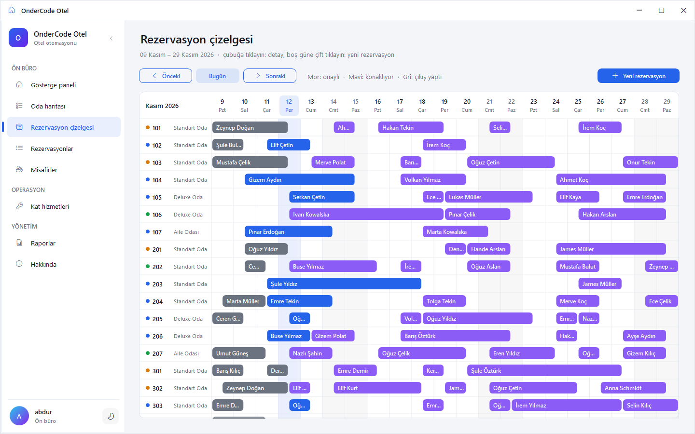
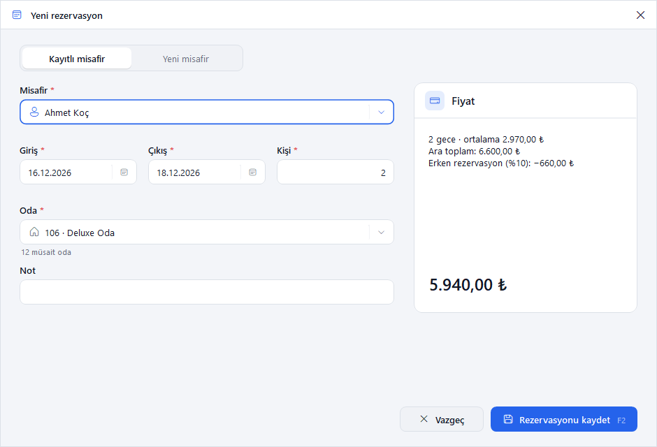
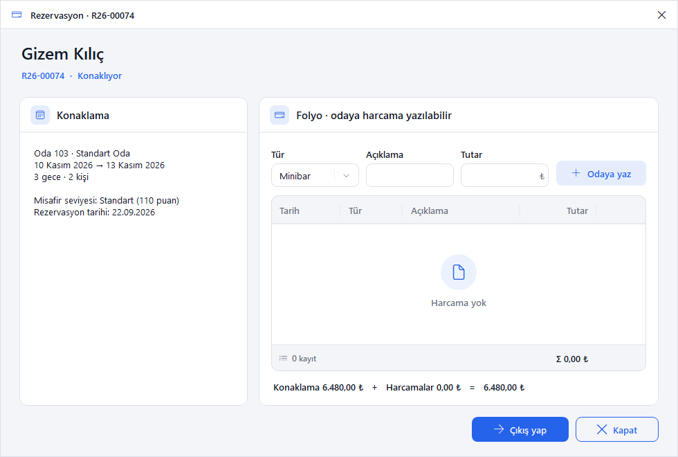

</p>

Çalıştırmak için `otel-calistir.bat` ya da:

```
dotnet run --project src/Apps/Otel/Otel.WinForms -c Release
```

Arayüz [Onda](https://ondercode.com/projeler/onda) bileşenlerini kullanır. Onda bu depoda derlenmiş kütüphane olarak durur (`lib/Onda`, MIT); ek bir şey kurmadan derlenir. Onda'nın kaynak koduyla çalışmak isteyenler için: deponun yanında `Onda` klasörü varsa proje oradan derlenir (`OndaProject` özelliğiyle yol değiştirilebilir). Veritabanı `%LocalAppData%\OnderCode\Otel\Otel.db`; silinirse uygulama örnek veriyle yeniden oluşturur. `otel-ekran-goruntuleri.bat` yukarıdaki ekran görüntülerini boş bir veritabanıyla yeniden üretir.

## OnderCode Otopark

Otopark gişesi ve araç yıkama birlikte. İlk açılışta örnek veriyle gelir: 74 park yeri (zemin, -1. kat, büyük araç, motosiklet; engelli ve elektrikli şarj yerleri), 5 yıkama paketi, 28 abone ve son dokuz haftanın araç hareketleri. Bütün plakalar ve isimler uydurmadır; telefon bilgisi yoktur.

| Ekran | Ne yapar |
|---|---|
| Gösterge paneli | İçerideki araç, doluluk, bugünkü otopark ve yıkama geliri, ortalama kalış; saatlik giriş (bugün ve olağan gün), son 30 gün ciro, yıkama kuyruğu özeti, son hareketler |
| Otopark haritası | Bölge bölge park yerleri; dolu yerde plaka, süre ve o anki ücret, yıkamadaki araçta durum noktası. Yere tıklayınca giriş, çıkış, yıkama siparişi, kullanım dışı bırakma |
| Araç hareketleri | İçeride / bugün / tümü, plaka araması, Excel çıktısı |
| Yıkama kuyruğu | Bekliyor → Yıkanıyor → Hazır → Teslim panosu; 3 yıkama yerine göre tahmini bitiş saati, yıkamacı atama |
| Abonelikler | Aylık abonelik, uzatma, biten ve yakında bitecek abonelikler, son 30 gün kullanım |
| Raporlar | Gelir (otopark + yıkama, araç sınıfı, paket ABC, ödeme türü; önceki dönemle karşılaştırmalı), yoğunluk saatleri (gün × saat ortalama doluluk, en yoğun dilimler), 7-30 günlük ciro tahmini; Excel, PDF ve CSV |

Kısayollar: F2 araç girişi, F3 plaka ile çıkış ve tahsilat, F4 yıkama siparişi.

İş kuralları Domain katmanında ve testli:

- **Tarife motoru:** ilk 15 dakika ücretsiz; ilk saat ve sonraki her başlamış saat ayrı ücretli, her 24 saat için günlük üst sınır. Araç sınıfına göre (otomobil, büyük araç, motosiklet) ayrı tarife.
- **Yıkama indirimi:** yıkama yaptıranın ilk 2 saati otoparktan düşülür. Abonelerden otopark ücreti alınmaz.
- **Plaka:** Türkiye plaka biçimi (il kodu 01-81, harf ve rakam sayısı kuralları) doğrulanır ve `34 XWQ 123` biçimine getirilir; aynı plaka iki kez içeride olamaz (veritabanında da süzgeçli benzersiz indeks).
- **Park yeri:** büyük araç yalnız büyük araç yerine, motosiklet yalnız motosiklet yerine; otomobile önce standart yer önerilir, engelli ve şarj yerleri en sona kalır. Kullanım dışı yere araç alınmaz.
- **Yıkama iş akışı:** Bekliyor → Yıkanıyor → Hazır → Teslim; yalnız bekleyen sipariş iptal edilir. Yıkaması bitmemiş araç çıkış yapamaz; otoparktaki aracın yıkaması çıkışta teslim edilir ve tutarı aynı fişe eklenir.

<p>
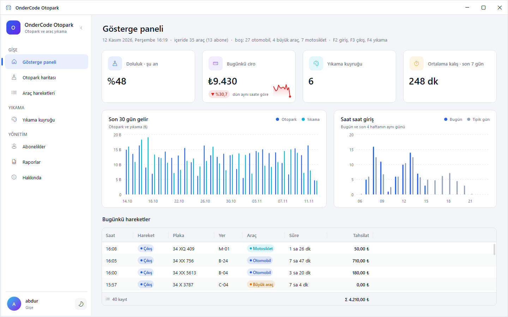
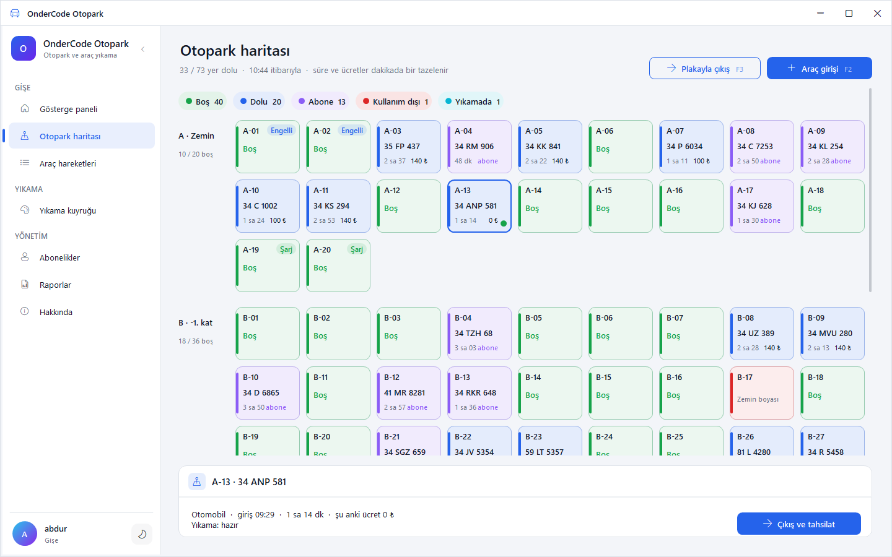
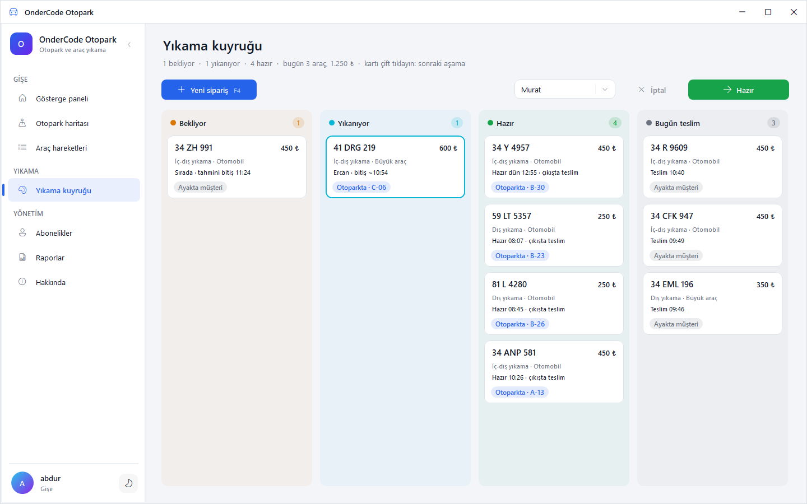
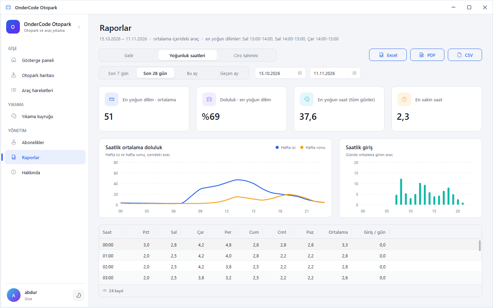
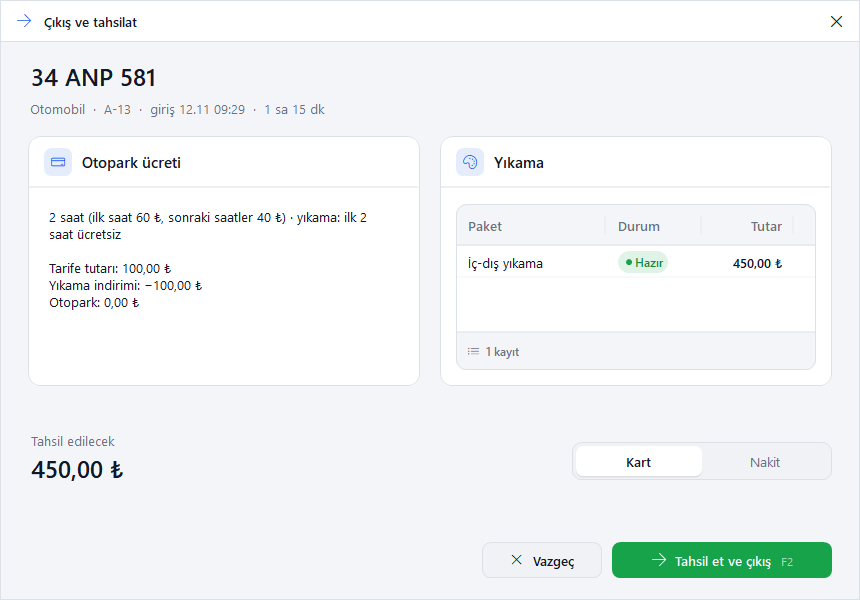
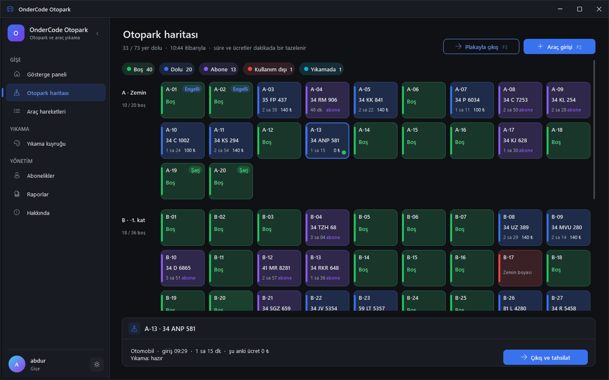
</p>

Çalıştırmak için `otopark-calistir.bat` ya da `dotnet run --project src/Apps/Otopark/Otopark.WinForms -c Release`. Örnek rapor çıktıları: [docs/otopark/ornek-raporlar](docs/otopark/ornek-raporlar).

## OnderCode Eczane

Bir eczanenin bütün işi tek uygulamada: reçeteli ve serbest satış, ilaç ve parti (SKT) takibi, ecza deposu siparişleri ve cari hesap, hasta geçmişi, reçetelerin geldiği kurumlar, personel ve izin, nöbet çizelgesi, demirbaş ve amortisman, SGK / özel sigorta faturaları, raporlar.

**Kişisel veri tutmaz:** hasta, personel ve kurum kayıtlarında T.C. kimlik numarası, telefon ve adres alanı yoktur. İlk açılışta örnek veriyle gelir: yaklaşık 190 ilaç ve ürün, 1.100 hasta, 10 sağlık kurumu, 4 ecza deposu, 7 personel, 24 demirbaş, yıl başından bu yana nöbetler ve son dokuz haftanın satış, sipariş, ödeme ve faturaları. Bütün ilaç, hasta, kurum ve depo adları uydurmadır.

| Ekran | Ne yapar |
|---|---|
| Gösterge paneli | Bugünkü ciro ve kâr, reçete / serbest satış sayısı, stok ve miad uyarıları, depo borcu ve kurum alacağı, sıradaki nöbet, izinliler, son 30 gün ciro, saatlik yoğunluk, en çok reçete gelen kurumlar |
| Satış (POS) | Hasta, kurum, branş, reçete rengi ve numarası; barkod ya da adla ürün. Her değişiklikte FEFO parti seçimi, kurum payı ve hasta katılım payı anında hesaplanır |
| Satışlar | Gün / hafta / ay, reçete ve serbest satış ayrımı, fiş ayrıntısı (hangi partiden düştüğü), iade |
| İlaçlar ve stok | Stok, kritik seviye, kaç günlük stok kaldığı, en yakın SKT, marj; ürün kartı: partiler, stok hareketleri, depo alış fiyatları, 60 günlük satış grafiği |
| Miad takibi | SKT geçmiş / 30 gün / 90 gün; satış hızına göre SKT'den önce satılamayacak kutu tahmini ve öneri; imha ve sayım |
| Sipariş önerisi | Son 28 günlük satış hızı, en az stok, eldeki ve yoldaki miktar; her ürün için iskonto ve mal fazlasıyla toplamda en ucuz depo; seçilenler depo başına tek siparişe dönüşür |
| Siparişler | Yoldaki ve teslim alınan siparişler; teslim almada parti no ve SKT girişi, stok partileri ve cari borç oluşur |
| Ecza depoları | İskonto, vade, sefer sayısı, MF kampanyaları, zamanında teslim oranı; cari ekstre, vadesi geçen borç, ödeme (en eski vadeden kapatılır) |
| Hastalar | Kurum, kronik rapor, reçete sayısı, son geliş; hasta geçmişi: düzenli ilaçlar, ortalama alım aralığı ve beklenen sonraki alım |
| Hastaneler | Reçetelerin en çok hangi kurumdan geldiği, son 30 gün / önceki 30 gün, kurum başına ciro ve en sık branş |
| Personel ve izin | Kıdem, yıllık izin hakkı (1-5 yıl 14, 5-15 yıl 20, 15+ yıl 26 iş günü), kullanılan / kalan izin, nöbet puanı, satış |
| Nöbet çizelgesi | Ay takvimi; otomatik adil dağıtım (yıl boyu puan dengesi, iki nöbet arası en az 2 gün, izinliler atlanır), elle atama, nöbet günü ekleme |
| Demirbaş | Doğrusal amortisman, net defter değeri, bu yılın gideri; bakım ve kalibrasyon takvimi, tamir, hurdaya ayırma |
| Kurum faturaları | Ay sonu SGK ve özel sigorta faturaları, tahsilat takibi |
| Raporlar | Satış, hastane (Pareto), ürün (ABC, yavaş dönen, stok devir hızı), ecza deposu, personel ve nöbet, ciro tahmini (Holt-Winters), demirbaş; Excel, PDF ve CSV |

Kısayollar: F2 reçeteli satış, F3 serbest satış, F4 ilaç listesi, F1 hakkında.

İş kuralları Domain katmanında ve testli:

- **Katılım payı:** reçete başına ilk 3 kutu 3 ₺, sonraki her kutu 1 ₺ + geri ödemeli ilaçta çalışanlardan %20, emeklilerden %10; kronik raporlu hastadan yüzdelik pay alınmaz. Özel sigortada hasta %20 öder.
- **Reçete rengi:** kırmızı ve yeşil reçeteli ilaçlar yalnız kendi renginde reçeteyle satılır; reçeteli ilaç serbest satışta satılamaz. Reçete geçerliliği beyaz reçetede 5, renkli reçetede 2 gün.
- **FEFO:** satış SKT'si en yakın partiden düşer; SKT'si geçmiş parti satılamaz. Serbest satışta indirim en çok %15.
- **Mal fazlası (MF):** kampanya eşiğine yuvarlama yalnız %30'dan fazla kutu eklemiyorsa yapılır; MF'li alımda birim maliyet bedelsiz kutularla bölünür.
- **Barkod:** EAN-13 kontrol hanesi doğrulanır.
- **İzin:** çakışan izin girilemez, yıllık izin hakkı aşılamaz; izin günlerindeki nöbetler boşaltılır.
- **Nöbet:** yalnız eczacı nöbetçi olabilir; gece 1, pazar 2, bayram 3 puan.

<p>
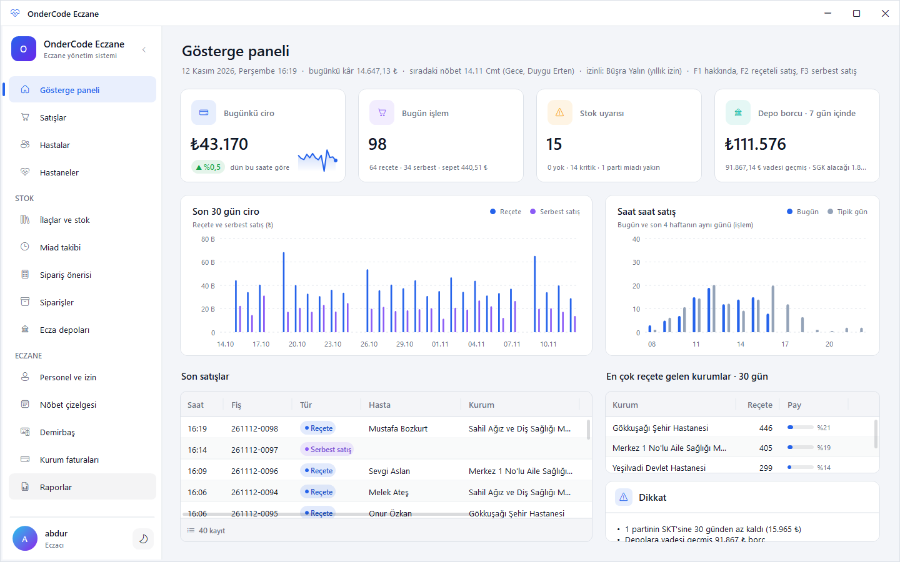
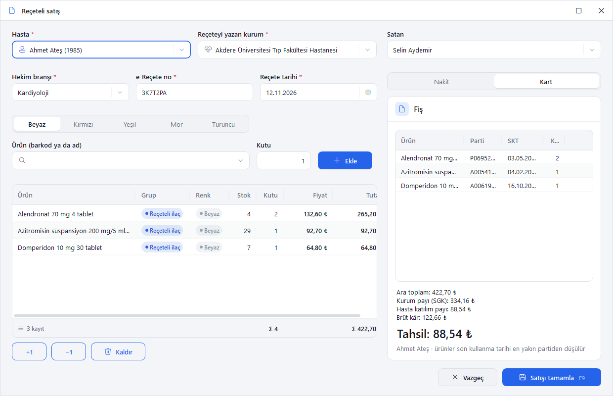
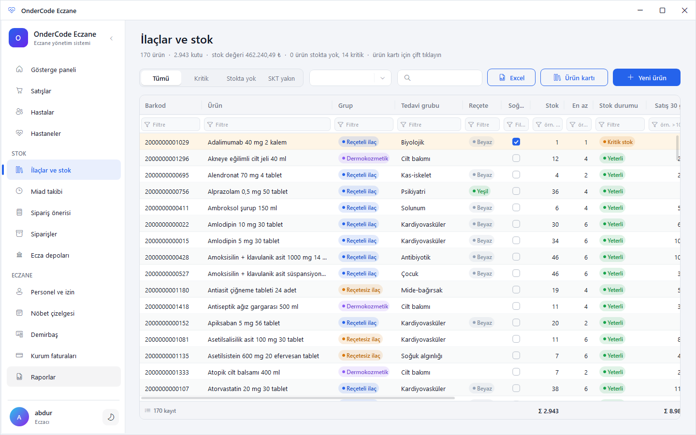
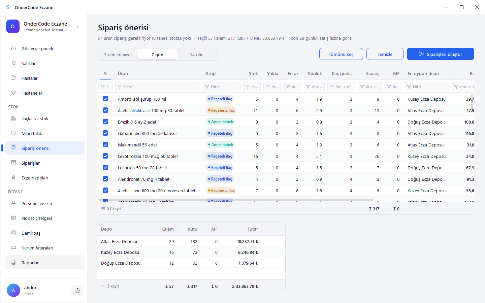
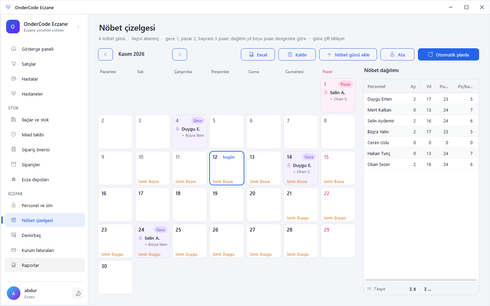
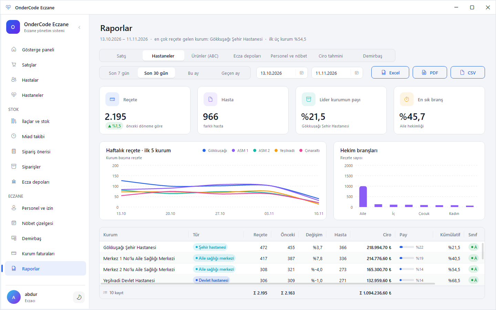
</p>

Çalıştırmak için `eczane-calistir.bat` ya da `dotnet run --project src/Apps/Eczane/Eczane.WinForms -c Release`. Örnek rapor çıktıları: [docs/eczane/ornek-raporlar](docs/eczane/ornek-raporlar).

## OnderCode Donanım

Bilgisayarın **donanım karnesi**: işlemci, anakart ve BIOS, bellek yuvaları, diskler, ekran kartı ve ekranlar, pil, Windows ve güvenlik ayarları tek uygulamada.
Her bileşene okul karnesi gibi 1–5 not verir (Zayıf … Pekiyi) ve asıl soruyu cevaplar: **"Bu bilgisayara ne alınır?"**
Arayüz baştan sona [Onda](https://ondercode.com/projeler/onda) bileşenleriyle yazıldı; bellek yuvaları ve anakart çizimi de birer Onda kontrolü.

| Ekran | Ne gösterir |
|---|---|
| Karne | Bilgisayarın özeti, genel ortalama halkası, altı bileşenin notu ve gerekçesi, öncelikli öneriler, alışveriş listesi |
| Bellek (RAM) | Anakart üzerinde yuvaların çizimi: dolu yuvada modül (boyut, tür, hız), boş yuvada kesik çizgi. Yuvanın üzerine gelince ayrıntı; toplam, dolu yuva, anakartın en fazla desteklediği bellek, çalışma hızı, tek/çift kanal, anlık kullanım |
| İşlemci ve anakart | Çekirdek / iş parçacığı, saat hızı, önbellek, sanallaştırma, anakart ve BIOS tarihi; canlı işlemci ve bellek grafiği |
| Depolama | NVMe / SATA SSD / HDD ayrımı, sağlık, sıcaklık ve çalışma saati (yönetici olarak açılırsa), bölümlerin doluluğu |
| Ekran kartı ve ekran | Tümleşik / harici, gerçek video belleği (WMI'nın 4 GB sınırına takılmadan), sürücü tarihi, bağlı ekranlar ve boyutları |
| Pil ve sistem | Pil sağlığı (fabrika kapasitesine göre), şarj döngüsü; Windows sürümü ve destek durumu, açık kalma süresi, UEFI, Güvenli Önyükleme, TPM, ağ bağdaştırıcıları |
| Öneriler ve rapor | Bütün öneriler ve kazanımları, alışveriş listesi, **PDF / Excel karne**, ikinci el ilanı için hazır metin |

Öneriler somuttur ve testlerle doğrulanır:

- **Bellek:** "Boş yuvaya 8 GB DDR4-2666 SO-DIMM takın": tek modülle tek kanalda çalışan belleği çift kanala geçirir. Bütün yuvalar doluysa daha büyük kit, anakartın sınırı aşılmaz; lehimli bellekte ekleme önerilmez.
- **XMP/EXPO:** modül 3600 MT/s için üretilmiş ama 2133'te çalışıyorsa (masaüstünde) BIOS ayarı önerilir; para gerektirmez.
- **Disk:** Windows sabit diskteyse SSD'ye geçiş, dolmak üzere olan bölüm, sağlığı bozulan diskte acil yedek.
- **Pil, Windows, güvenlik:** yıpranmış pil, desteği biten Windows 10, kapalı Güvenli Önyükleme, eski TPM, günlerdir yeniden başlatılmayan sistem.

Bilgiler Windows'un WMI arayüzünden ve kayıt defterinden okunur (System.Management, MIT). **Uygulama internete bağlanmaz; seri numarası, MAC adresi ve kullanıcı bilgisi okumaz.** Okunamayan bölümler (ör. yönetici izni isteyen disk sıcaklığı) taramayı durdurmaz, "Tarama notları"nda yazar.

Ekran görüntülerinde ve tanıtım videosunda iki **kurgusal** örnek bilgisayar kullanılır (marka ve model adları uydurmadır); uygulamada da "Örnek" seçenekleriyle açılabilirler.

<p>
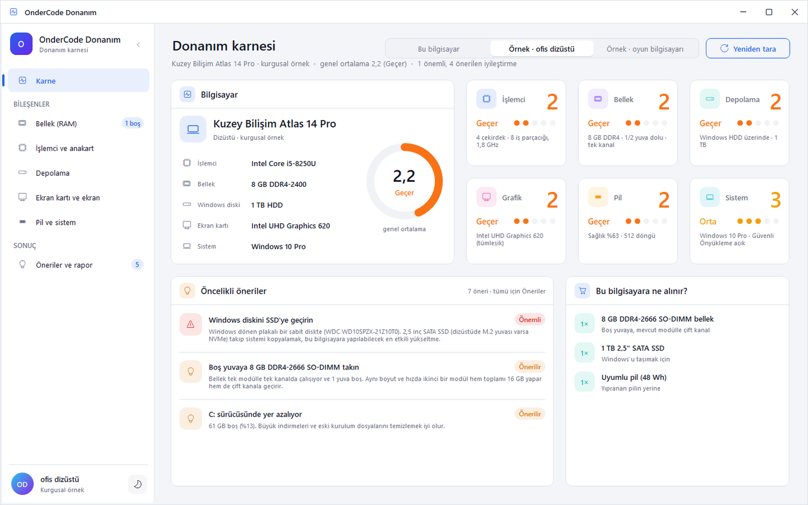
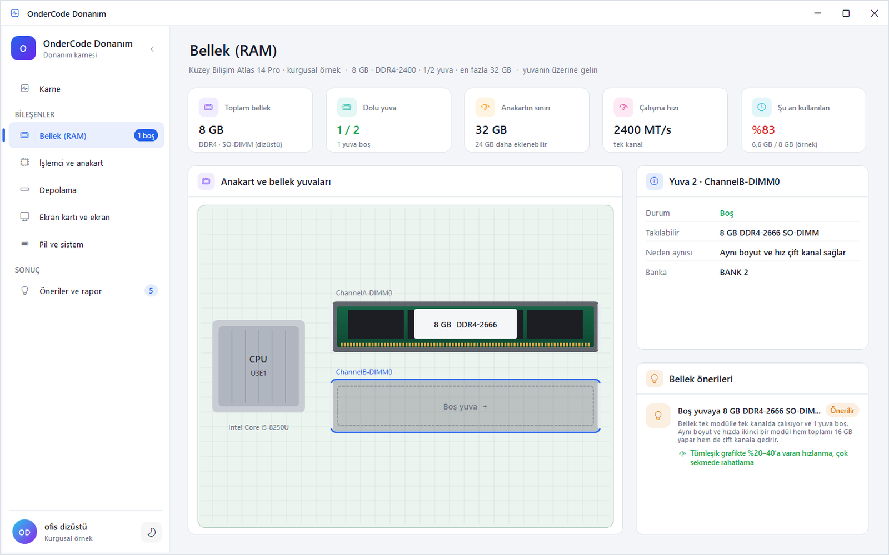
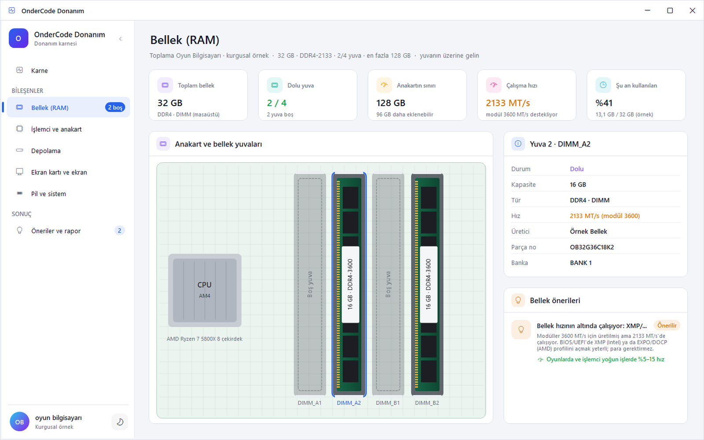
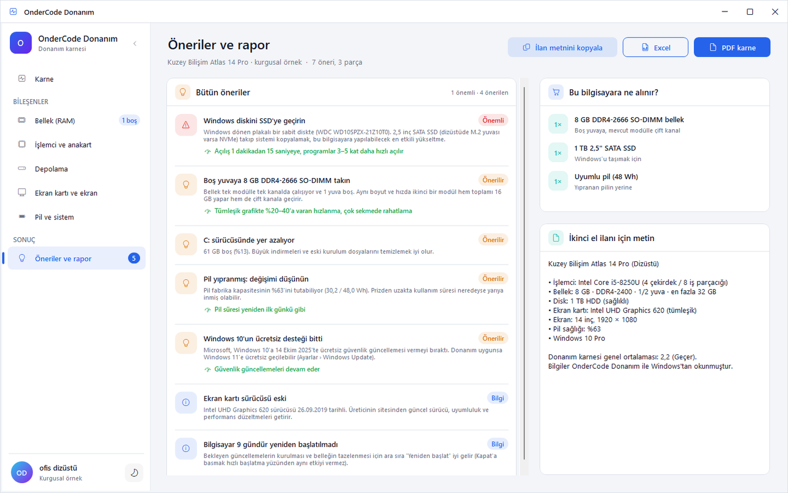
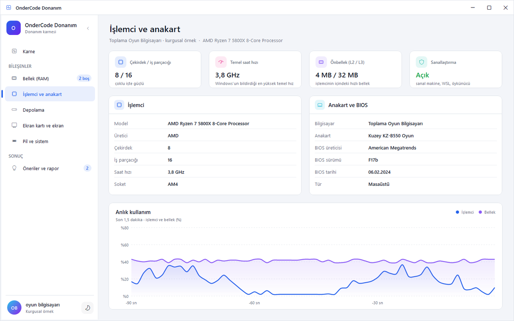
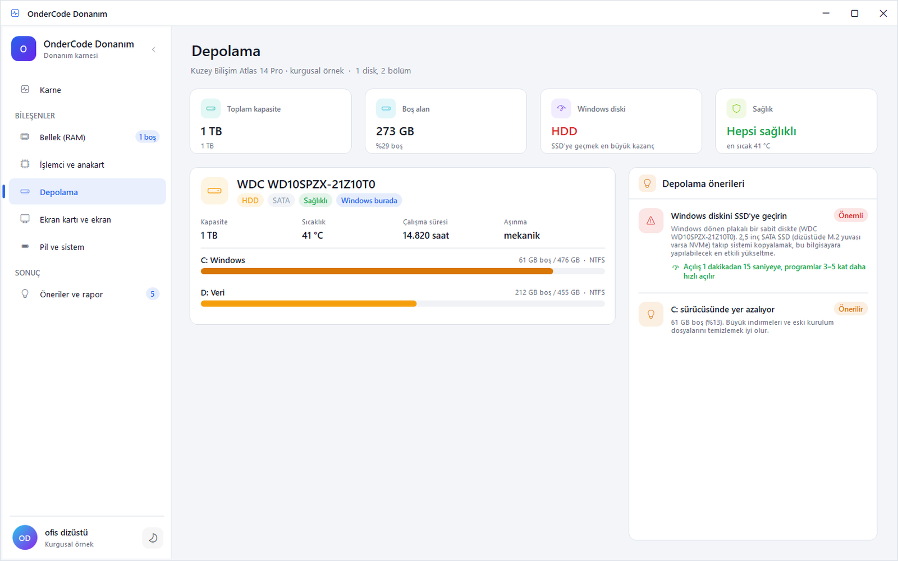
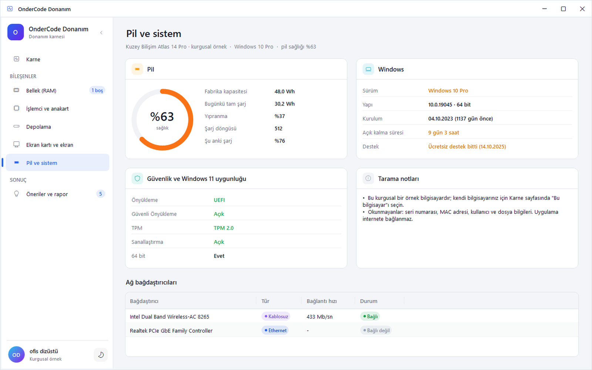
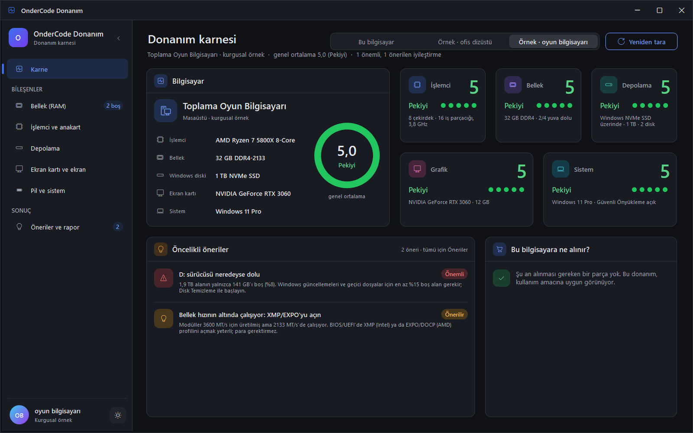
</p>

Çalıştırmak için `donanim-calistir.bat` ya da `dotnet run --project src/Apps/Donanim/Donanim.WinForms`. Kurulumsuz Windows paketi: [ondercode.com/projeler/ondercode-donanim](https://ondercode.com/projeler/ondercode-donanim).

## OnderCode Sinema

Bir sinemanın sıfırdan bilet kesimine kadar bütün işi, **web** üzerinde: salon ve koltuk planı tasarımı, film ve afiş, seans planı, fiyat kuralları, gişe satışı, müşteri sitesinden online koltuk seçimi, QR kodlu e-bilet, kapıda bilet okutma, büfe, personel ve raporlar.
Arayüz, Onda'nın web sürümü **[Onda.Web](https://ondercode.com/projeler/onda)** bileşenleriyle (Blazor, sunucu tarafı) yazıldı; alt katmanlar diğer uygulamalarla aynı ortak çekirdeği kullanır.

İlk açılışta örnek veriyle gelir: 12 film (2'si yakında), 6 salon (biri VIP), 4 bilet türü, 13 büfe ürünü, 8 personel ve son üç haftanın seans, satış, kapı girişi ve iadeleri. **Bütün filmler, afişler ve kişiler uydurmadır**; afişler bu proje için sıfırdan çizildi. Ödeme alınmaz (demo ödeme).

| Ekran | Ne yapar |
|---|---|
| Müşteri sitesi | Vizyondaki filmler ve 7 günlük seans programı, film sayfası, yakında gelecekler. Online satışı kapanmış seanslar görünür ama seçilemez |
| Koltuk seçimi | Canlı koltuk planı: seçilen koltuk 5 dakika size ayrılır, başka ekranlarda anında "başkasının sepetinde" görünür; geri sayım, bilet türü, demo ödeme |
| E-bilet | QR kodlu bilet (QR yalnız satış kodunu içerir), yazdır / PDF; "Biletim" sayfasından kodla tekrar açılır |
| Gösterge | Bugünkü bilet, ciro, doluluk, büfe; dünle karşılaştırma, 14 günlük ciro, şu an oynayan seanslar ve içerideki seyirci, haftanın filmleri |
| Filmler | Afiş yükleme (JPG/PNG/WebP, içerik imzası kontrol edilir), tür, süre, yaş sınırı, vizyon durumu, öne çıkan film |
| Salonlar ve tasarımcı | Sürükle-boya koltuk tasarımcısı: standart, VIP, çift (sevgili) koltuk, engelli yeri, koridor; tek tıkla sıra/sütun doldurma, hazır şablonlar. Satılmış koltuğu silen değişiklik engellenir |
| Seanslar | Salon × saat zaman çizelgesi; reklam ve temizlik süresi hesaba katılır, çakışan seans açılamaz, ilk boş saat önerilir, birkaç güne birden seans; iptal edilen seansın satışları iade edilir |
| Fiyatlar | Bilet türleri (tam, öğrenci, çocuk, 65+), VIP / çift koltuk ve 3D farkı, halk günü ve matine indirimi; örnek fiyat tablosu |
| Gişe | Seans listesi, koltuk planı, bilet türü, büfe ürünleri, nakit/kart; aynı koltuk iki kez satılamaz |
| Kapı kontrol | QR okuyucu klavye gibi çalışır; kapı açılma saati, biten / iptal seans, iade edilmiş ya da ikinci kez okutulan bilet uyarıları, belge gerektiren bilet türü uyarısı |
| Satışlar, büfe, personel | Satış listesi ve iade, büfe ürünleri ve kategori payı, görev ve vardiya; her listede arama ve Excel |
| Raporlar | Günlük ciro, film ve salon performansı, bilet türleri, gişe/online payı, ödeme dağılımı, gün × saat yoğunluk haritası |

Yetkiler göreve göre: **yönetici** her şeyi, **gişe** gişe ekranı ve satışları, **kapı görevlisi** kapı kontrolünü görür. Demo girişinde parola yoktur, personel kartı seçilir.

İş kuralları Domain katmanında ve testli:

- **Seans:** bitiş = başlangıç + reklam + film süresi; salon temizlik süresi sonunda hazır olur. Aynı salonda çakışan seans açılamaz; 3D seans yalnız 3D salonda.
- **Fiyat:** halk günü (%40) ve matine indiriminden büyük olan uygulanır; sonra koltuk (VIP, çift) ve 3D farkı eklenir.
- **Koltuk:** bir seansta bir koltuk yalnız bir kez satılır (veritabanında iade edilmeyen biletler için süzgeçli benzersiz indeks); iade edilen koltuk yeniden satılabilir. Online satış seanstan 15 dakika önce kapanır.
- **Kapı:** bilet seanstan 45 dakika önce okutulabilir; kullanılmış bilet iade edilemez, aynı bilet ikinci kez kullanılamaz.
- **Bilet kodu:** karışan harfler (O/0, I/1) olmadan 8 karakter, `ABCD-2345`; boşluk, tire ve küçük harf fark etmez.

<p>
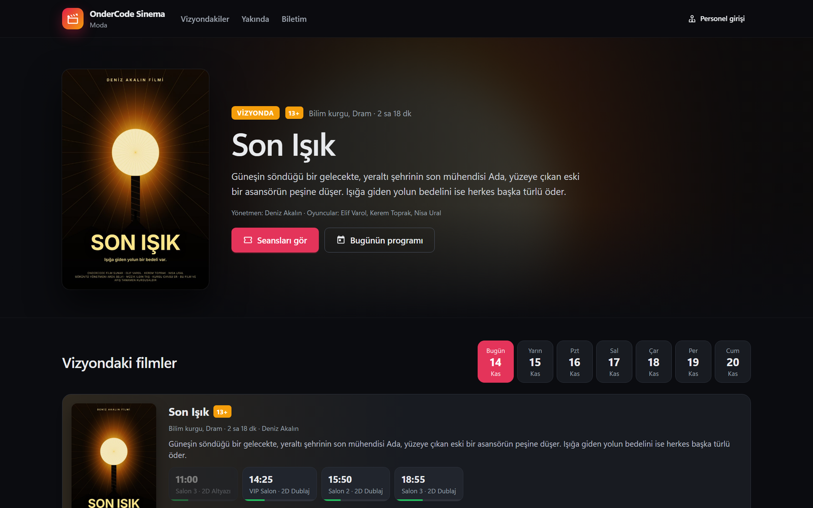
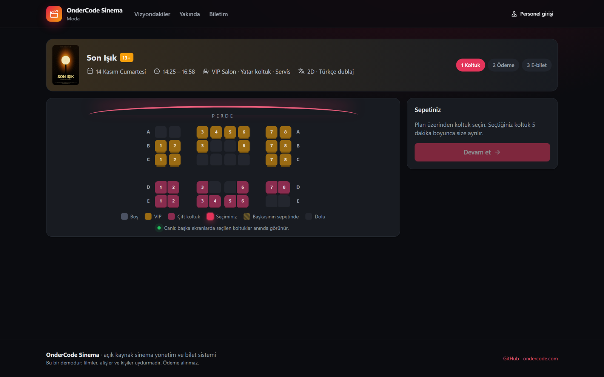
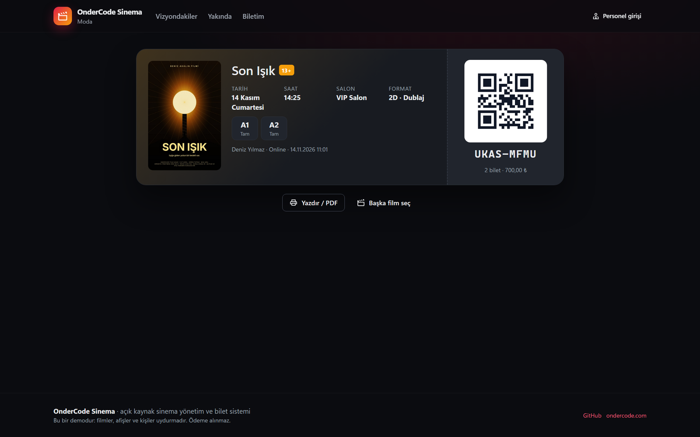
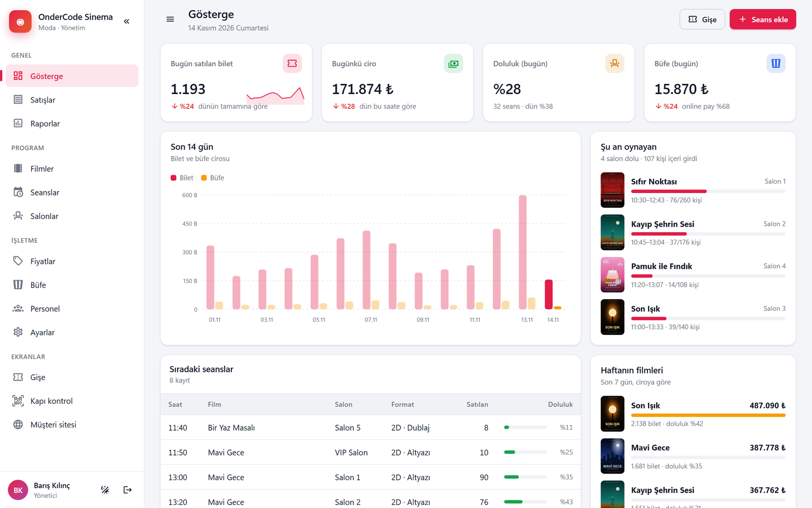
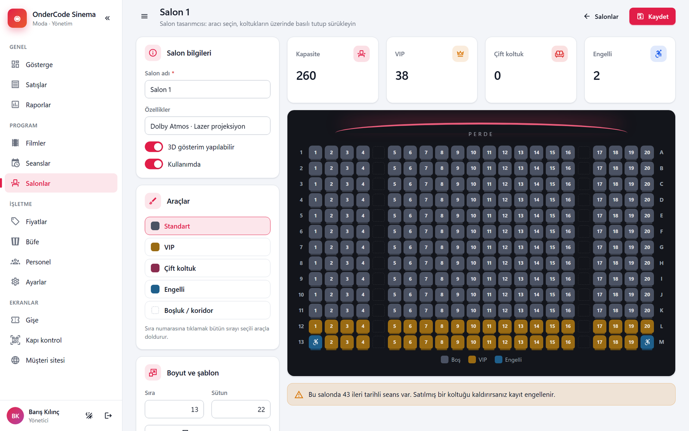
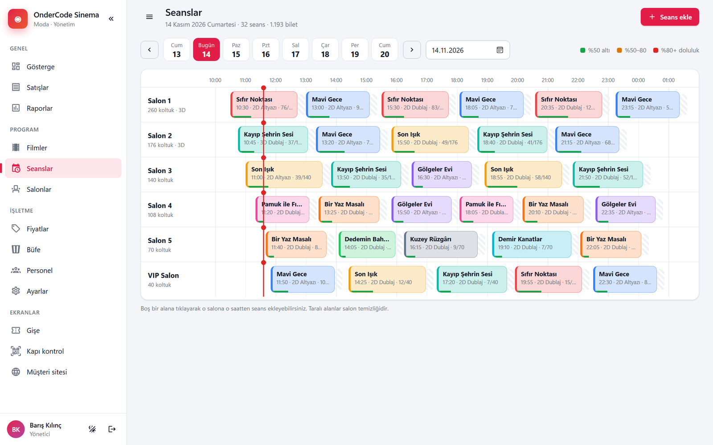
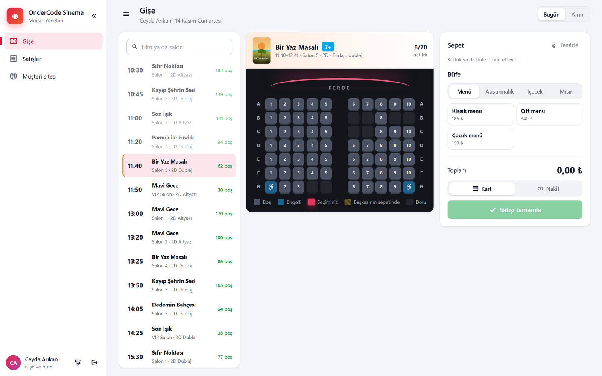
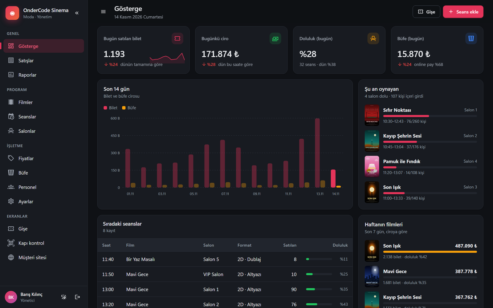
</p>

Çalıştırmak için `sinema-calistir.bat` ya da `dotnet run --project src/Apps/Sinema/Sinema.Web` → http://localhost:5280. Onda.Web projesi yan klasörde (`..\Onda`) bulunursa kaynaktan, yoksa `lib\Onda\Onda.Web.dll` üzerinden derlenir. Kurulumsuz Windows paketi: [ondercode.com/projeler/ondercode-sinema](https://ondercode.com/projeler/ondercode-sinema).

## Raporlama ve analiz

Uygulamalar rapor verisini biçimden bağımsız bir `ReportDocument` olarak kurar: göstergeler, grafikler, tablolar, notlar. Aynı belge üç biçime yazılır.

```csharp
var doc = new ReportDocument { Title = "Gelir ve Doluluk Raporu", Organization = "OnderCode Otel" };
doc.Kpis.Add(new ReportKpi("Doluluk", ReportFormat.Percent(0.784)));
doc.Tables.Add(ReportTable.For("Günlük döküm", gunler)
    .Date("Tarih", g => g.Tarih)
    .Percent("Doluluk", g => g.Doluluk)
    .Money("Oda geliri", g => g.Gelir, total: true)
    .Build());

ReportExporters.Save(doc, "rapor.xlsx");   // ya da .pdf / .csv
```

| Biçim | Nasıl |
|---|---|
| Excel | Harici paket yok; Office Open XML doğrudan yazılır. Her tablo ayrı sayfada, başlık satırı dondurulmuş, süzgeç açık. Sayılar, tarihler ve tutarlar gerçek Excel değeri (₺ biçimli); toplam satırı süzgece duyarlı `SUBTOTAL` formülü. |
| PDF | PDFsharp ile A4 (dikey ya da yatay): gösterge kutuları, çizgi/çubuk grafik, sayfalara bölünen tablolar (başlık her sayfada tekrar eder), "Sayfa x / y". Yazı tipi gömülür; Türkçe karakterler ve ₺ her bilgisayarda aynı görünür. |
| CSV | Türkçe Excel'in doğrudan açabileceği biçim: noktalı virgül, ondalık virgül, UTF-8. `=`, `+`, `-`, `@` ile başlayan metinler formül olarak çalışmasın diye etkisizleştirilir. |

Analiz araçları (`OnderCode.Analytics`) Application katmanında kullanılır ve hiçbir pakete bağlı değildir:

- **Pareto / ABC:** kalemleri değere göre sıralar, kümülatif payı hesaplar; ilk %80 A, sonraki %15 B, kalan C.
- **Tahmin:** doğrusal trend, Holt (sönümlü trend) ve toplamsal Holt-Winters (trend + mevsim). Parametreler ızgara aramasıyla bulunur. `Forecast.Auto` serinin son bölümünü ayırıp yöntemleri o bölüm üzerinde yarıştırır ve kazananı kullanır; her tahminle birlikte yaklaşık %80 aralık ve hata ölçüleri (MAE, RMSE, MAPE) döner.

Örnek çıktılar (uygulamanın ürettiği gerçek dosyalar): [gelir ve doluluk PDF](docs/otel/ornek-raporlar/gelir-ve-doluluk.pdf) · [Excel](docs/otel/ornek-raporlar/gelir-ve-doluluk.xlsx) · [CSV](docs/otel/ornek-raporlar/gelir-ve-doluluk.csv) · [misafir değeri PDF](docs/otel/ornek-raporlar/misafir-degeri-abc.pdf) · [doluluk tahmini PDF](docs/otel/ornek-raporlar/doluluk-tahmini.pdf)

<p>


</p>

## Bilinçli tercihler

- **MediatR ve AutoMapper yok.** İkisi de 2025'te ticari lisansa geçti. Komut/sorgu dağıtıcı küçük ve kendi kodumuz (`OnderCode.Application/Messaging`), eşleme elle ve açık.
- **FluentValidation var.** Apache 2.0 lisanslı, ücretsiz.
- **SQLite sürümü sabitlendi.** EF Core 10'un ilk sürümlerinin getirdiği yerel SQLite'ta yüksek önemli bir açık (CVE-2025-6965) vardı; `SQLitePCLRaw.bundle_e_sqlite3` açıkça düzeltmeli sürüme (2.1.13) sabitlendi, daha eskisine düşülmez.
- **QuestPDF yok.** Belirli bir gelirin üstündeki şirketler için ücretli lisans istiyor. PDF için PDFsharp.
- **PDFsharp 6.2.4'te sabit.** 6.2.4 MIT lisanslı son sürüm; 6.5.0 ile birlikte PDFsharp AGPL / ticari çift lisansa geçti. Yükseltilmemeli.
- **Excel için paket yok.** EPPlus ücretli; ClosedXML'in kullandığı SixLabors.Fonts'un yeni sürümleri gelir sınırlı lisanslı. Gereken kadarını yazan küçük bir XLSX yazıcısı daha sade.
- **Arayüzde Onda.** Standart WinForms kontrolleri yerine [Onda](https://ondercode.com/projeler/onda) bileşenleri.
- **Generic repository, ama ince.** EF Core zaten bir iş birimi; buradaki katman onu gizlemek için değil, Application katmanını EF'den bağımsız tutmak ve ortak kuralları (Türkçe arama, sayfalama, hata çevirisi) tek yerde toplamak için var. Ağır rapor sorguları Infrastructure'da doğrudan DbContext ile yazılır.

## İndir

Hazır uygulama (kurulum gerekmez, Windows 10/11 x64): [ondercode.com/projeler/ondercode-suite](https://ondercode.com/projeler/ondercode-suite)

## Derleme ve test

```
dotnet test OnderCode.Suite.slnx
```

ya da `test.bat` (sonuç `test.log` dosyasına yazılır). Gerekli olan tek şey .NET 10 SDK.

---
Abdurrahman Önder · [ondercode.com](https://ondercode.com)
