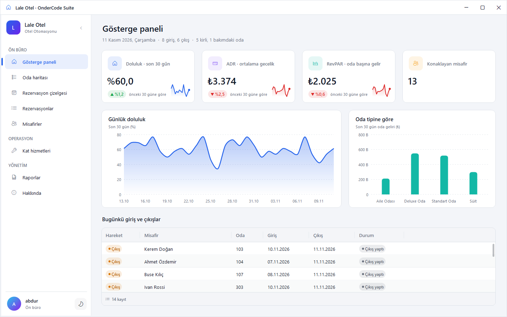
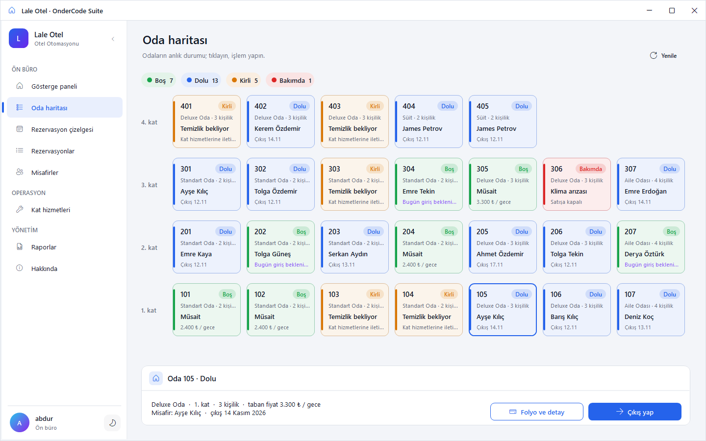
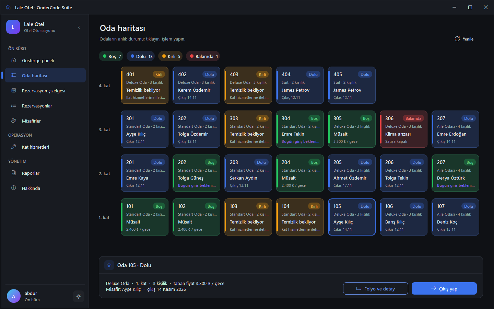
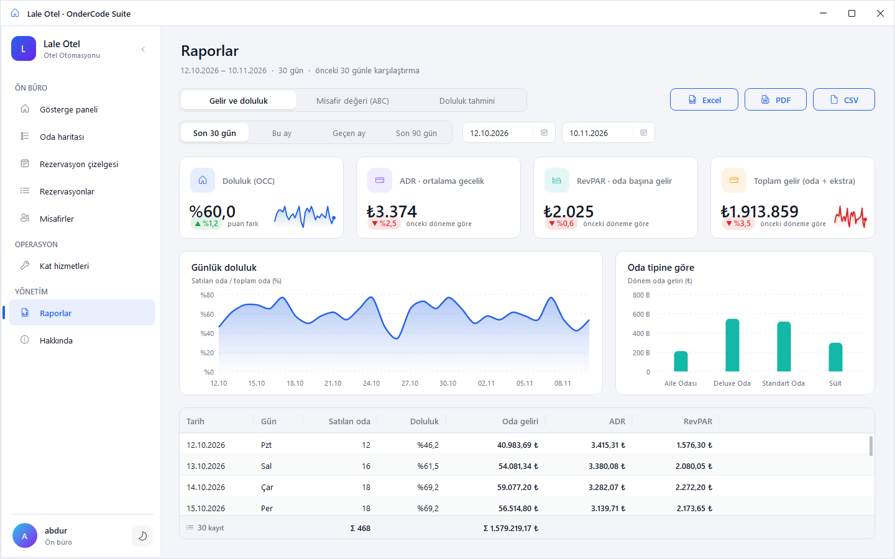
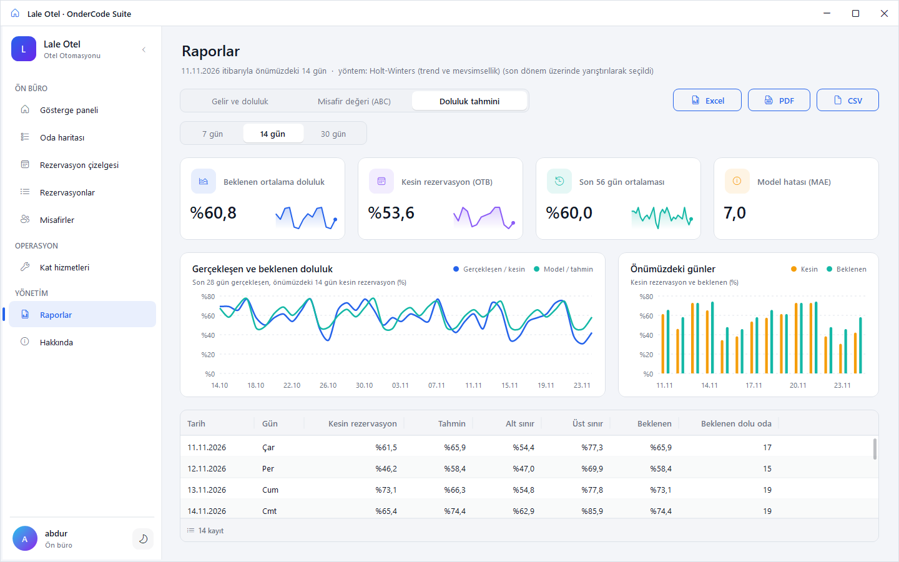

# OnderCode Suite

.NET 10 + WinForms ile yazılmış, açık kaynak, uçtan uca çalışan otomasyon uygulamaları ve onların ortak altyapısı.
Kurulum gerektirmez: SQL Server yok, bağlantı ayarı yok. Uygulama ilk açılışta veritabanını oluşturur, migration'ları uygular ve örnek veriyi yükler.

**Lisans:** MIT. Ücretli ya da gelir sınırlı lisans isteyen hiçbir paket kullanılmaz.

## Çözüm yapısı

```
OnderCode.Suite/
├─ src/
│  ├─ Shared/
│  │  ├─ OnderCode.Kernel        Bağımlılıksız çekirdek: Entity tabanları, Specification,
│  │  │                          IRepository / IUnitOfWork sözleşmeleri, Türkçe metin yardımcıları
│  │  ├─ OnderCode.Data          EF Core + SQLite: SuiteDbContext, Repository, UnitOfWork,
│  │  │                          denetim, yumuşak silme, Türkçe sıralama/arama, başlatıcı
│  │  ├─ OnderCode.Application   Komut/sorgu dağıtıcı, davranış hattı (log, hata çevirisi,
│  │                          FluentValidation), Result türü, alan olayı dağıtıcısı
│  │  ├─ OnderCode.Analytics     Bağımlılıksız analiz: Pareto/ABC, doğrusal trend, Holt, Holt-Winters
│  │  ├─ OnderCode.Reporting     Rapor modeli; Excel (kendi yazıcımız), PDF (PDFsharp), CSV
│  │  └─ OnderCode.WinForms      (sırada) Onda bileşenleri üzerine uygulama kabuğu, DI, navigasyon
│  └─ Apps/                      her uygulama 4 katman: Domain · Application · Infrastructure · WinForms
│     ├─ Otel/                     ✔ hazır
│     ├─ Otopark/                  (sırada)
│     ├─ Eczane/
│     ├─ SiteYonetimi/
│     ├─ Lojistik/
│     └─ Personel/
└─ tests/
   ├─ OnderCode.Data.Tests          Gerçek SQLite dosyası üzerinde veri katmanı testleri
   ├─ OnderCode.Application.Tests   Dağıtıcı + hat + veri katmanı birlikte, uçtan uca
   ├─ OnderCode.Reporting.Tests     Pareto ve tahmin doğruluğu; Excel/PDF/CSV çıktılarının yapısı
   └─ Otel.Tests                    Fiyat motoru, çakışma kuralı, KPI hesabı, raporlar, örnek veriyle uçtan uca akış
```

Bağımlılık yönü tek taraflıdır: `WinForms → Infrastructure → Application → Domain → Kernel`.
Kernel ve Data `net10.0` hedefler (Windows'a bağlı değildir); ileride aynı çekirdek web veya mobil arayüzle de kullanılabilir.

## Veri katmanı neler yapıyor?

| Konu | Yaklaşım |
|---|---|
| Sıfır kurulum | `%LocalAppData%\OnderCode\{Uygulama}\{Uygulama}.db`. Exe'nin yanında `portable` dosyası varsa veritabanı `Data\` klasöründe durur. |
| Şema | Migration varsa `Migrate()`, yoksa (prototip) `EnsureCreated()`. Başlangıç verisi `ISeeder` ile, tekrar çalışmaya dayanıklı. |
| DbContext ömrü | `IDbContextFactory` + kısa ömürlü `IUnitOfWork`. Her işlem kendi bağlamını açar ve kapatır; form boyunca açık kalan bağlamın getirdiği eski veri ve bellek sorunları olmaz. |
| Türkçe | Bütün metin kolonları Türk alfabesine göre sıralanır (Ç, C'den sonra; Iğdır, İzmir'den önce). Eşitlik ve benzersiz indeksler büyük/küçük harf duyarsızdır (`İST` = `ist`). `Search()` Türkçe karakter duyarsız arar (`sanliurfa` → Şanlıurfa) ve bu iş veritabanında yapılır. |
| Para | SQLite'ta decimal tür yok. Tutarlar 4 hane hassasiyetle tam sayı saklanır; toplama, sıralama ve karşılaştırma SQL'de, kuruş kaybı olmadan çalışır. |
| Denetim | `CreatedAt/By`, `UpdatedAt/By` otomatik ve UTC. Zaman `TimeProvider` ile alınır, testte sabitlenebilir. |
| Yumuşak silme | `ISoftDeletable` varlıklarda silme satırı işaretler; sorgular silinenleri kendiliğinden gizler, `WithDeleted()` ile görünür. |
| Eşzamanlılık | Her kayıtta artan `Version`. İki kişi aynı kaydı düzenlerse ikincisi anlaşılır bir uyarı alır. |
| Silme güvenliği | Zincirleme silme varsayılan olarak kapalı. İlişkili kaydı olan satır silinemez; gerçek bütünlerde (sipariş-satır) açıkça açılır. |
| Hatalar | SQLite kısıtlama hataları `DuplicateRecordException`, `ReferenceInUseException`, `ConcurrencyConflictException` gibi kullanıcıya gösterilebilir Türkçe istisnalara çevrilir. |
| Alan olayları | Varlıklar olay biriktirir; kayıt (varsa transaction commit'i) başarıyla bittikten sonra yayınlanır. |
| Performans | WAL modu, `synchronous=NORMAL`, liste sorguları varsayılan olarak izlenmez, ekran listeleri için projeksiyon. |

## Uygulama katmanı

Ekranlar yalnızca `ISender` ile konuşur; iş kuralları işleyicilerde, doğrulama doğrulayıcılarda durur.

| Parça | Görevi |
|---|---|
| `ICommand`, `ICommand<T>`, `IQuery<T>` | Ekranın gönderdiği mesajlar. Yanıt her zaman `Result` / `Result<T>`. |
| `ISender` | Mesajı işleyicisine ulaştırır. İstek türü başına bir kez yansıma, sonra önbellek. Her istek kendi DI kapsamında. |
| Davranış hattı | Dıştan içe: **Log** (süre, uyarı, hata) → **Alan istisnası çevirisi** (bulunamadı, mükerrer, eşzamanlılık → başarısız `Result`) → **Doğrulama** (FluentValidation, Türkçe mesajlar) → işleyici. |
| `Result` | Ekran try/catch yazmaz: `if (!sonuc.IsSuccess) form.HatalariGoster(sonuc.Errors)`. Her hatanın `Field` bilgisi var, ilgili kutu işaretlenebilir. |
| `IDomainEventHandler<T>` | Kayıt başarıyla bitince çalışır (ör. rezervasyon onaylandı → odayı dolu yap). |
| `TurkishRules` | `RuleFor(x => x.Tckn).NotEmpty().Tckn()`, `.Vkn()`, `.Iban()` |
| `PagedQuery<T>` | Liste ekranlarının ortak sorgusu: sayfa, sayfa boyutu, Türkçe arama. |

```csharp
public sealed record MusteriKaydet(string Ad, string Tckn) : ICommand<int>;

public sealed class MusteriKaydetDogrulayici : AbstractValidator<MusteriKaydet>
{
    public MusteriKaydetDogrulayici()
    {
        RuleFor(x => x.Ad).NotEmpty().MaximumLength(100);
        RuleFor(x => x.Tckn).NotEmpty().Tckn();
    }
}

public sealed class MusteriKaydetIsleyici(IUnitOfWorkFactory uow) : ICommandHandler<MusteriKaydet, int>
{
    public async Task<Result<int>> HandleAsync(MusteriKaydet komut, CancellationToken ct)
    {
        await using var u = uow.Create();
        var musteri = new Musteri(komut.Ad, komut.Tckn);
        u.Repository<Musteri>().Add(musteri);
        await u.SaveChangesAsync(ct);
        return musteri.Id;
    }
}

// Ekranda
var sonuc = await sender.SendAsync(new MusteriKaydet(adKutusu.Text, tcknKutusu.Text));
```

## Veri katmanı kullanımı

```csharp
// Bağlam: yalnızca DbSet'ler. Aynı derlemedeki IEntityTypeConfiguration sınıfları otomatik uygulanır.
public sealed class OtelDbContext(DbContextOptions<OtelDbContext> options) : SuiteDbContext(options)
{
    public DbSet<Oda> Odalar { get; set; } = null!;
}

// Açılış
services.AddSuiteData<OtelDbContext>(o => o.AppName = "Otel")
        .AddSeeder<OtelDbContext, OdaSeeder>();
await provider.GetRequiredService<DatabaseInitializer<OtelDbContext>>().InitializeAsync();

// Okuma: Türkçe arama + sıralama + sayfalama, hepsi SQL'de
await using var uow = uowFactory.Create();
var sayfa = await uow.Repository<Oda>().PagedAsync(
    new Specification<Oda>().Search(arama, o => o.No, o => o.Aciklama).OrderBy(o => o.No),
    page: 1, pageSize: 50);

// Yazma
var oda = await uow.Repository<Oda>().GetRequiredAsync(id);
oda.TemizlikTamamlandi();
await uow.SaveChangesAsync();   // denetim, sürüm, olaylar kendiliğinden
```

## Otel Otomasyonu

Kurulumsuz çalışan küçük bir otel ön büro uygulaması. İlk açılışta "Lale Otel" örnek verisiyle (26 oda, 140 kurgusal misafir, 4 aylık rezervasyon geçmişi ve geleceği) dolu gelir. Örnek verideki bütün isimler uydurmadır; kimlik ve telefon bilgisi yoktur.

| Ekran | Ne yapar |
|---|---|
| Gösterge paneli | Son 30 gün doluluk, ADR, RevPAR ve oda geliri; önceki 30 günle karşılaştırma, günlük doluluk trendi, oda tipine göre gelir, bugünkü giriş/çıkışlar |
| Oda haritası | Katlara göre odalar, anlık durum (boş, dolu, kirli, bakımda). Odaya tıklayınca alt çubukta bilgi ve işlem: giriş, çıkış, folyo, rezervasyon, temizlendi, bakıma al |
| Rezervasyon çizelgesi | Oda × gün zaman çizelgesi; boş hücreye tıklayınca o oda ve tarih için yeni rezervasyon |
| Rezervasyonlar | Türkçe karakter duyarsız arama, duruma göre süzme, ayrıntı ve folyo |
| Misafirler | Konaklama sayısı, sadakat puanı ve seviyesi (Standart, Gümüş, Altın) |
| Kat hizmetleri | Çıkışta otomatik açılan temizlik görevleri, atama ve tamamlama |
| Raporlar | Gelir ve doluluk (önceki dönemle karşılaştırmalı), misafir değeri (Pareto / ABC), 7-30 günlük doluluk tahmini; Excel, PDF ve CSV çıktısı |

İş kuralları Domain katmanında ve testli:

- **Fiyat motoru:** oda tipinin taban fiyatı × sezon katsayısı (çakışan sezonlarda en yüksek olan) × hafta sonu katsayısı (cuma ve cumartesi geceleri), 30 gün önceden yapılan rezervasyona erken rezervasyon indirimi. Her gece ayrı fiyatlanır.
- **Çakışma kuralı:** aynı odaya kesişen tarihlerde ikinci rezervasyon açılamaz. Kontrol ve kayıt tek transaction içinde yapılır.
- **Oda yaşam döngüsü:** kirli ya da bakımdaki odaya giriş yapılamaz; çıkış odayı kirliye çeker ve temizlik görevi açar, görev tamamlanınca oda yeniden satışa çıkar.
- **Sadakat:** her konaklanan gece puan kazandırır; 200 puanda Gümüş, 500 puanda Altın.
- **KPI:** doluluk = satılan gece / satılabilir gece, ADR = oda geliri / satılan gece, RevPAR = oda geliri / satılabilir gece. Bakımdaki odalar satılabilir geceden düşülür.

<p>





</p>

Çalıştırmak için `otel-calistir.bat` ya da:

```
dotnet run --project src/Apps/Otel/Otel.WinForms -c Release
```

Arayüz [Onda](https://ondercode.com/projeler/onda) bileşenlerini kullanır; Onda deposu bu deponun yanındaki `Onda` klasöründe beklenir (`OndaProject` özelliğiyle değiştirilebilir). Veritabanı `%LocalAppData%\OnderCode\Otel\Otel.db`; silinirse uygulama örnek veriyle yeniden oluşturur. `otel-ekran-goruntuleri.bat` yukarıdaki ekran görüntülerini boş bir veritabanıyla yeniden üretir.

## Raporlama ve analiz

Uygulamalar rapor verisini biçimden bağımsız bir `ReportDocument` olarak kurar: göstergeler, grafikler, tablolar, notlar. Aynı belge üç biçime yazılır.

```csharp
var doc = new ReportDocument { Title = "Gelir ve Doluluk Raporu", Organization = "Lale Otel" };
doc.Kpis.Add(new ReportKpi("Doluluk", ReportFormat.Percent(0.784)));
doc.Tables.Add(ReportTable.For("Günlük döküm", gunler)
    .Date("Tarih", g => g.Tarih)
    .Percent("Doluluk", g => g.Doluluk)
    .Money("Oda geliri", g => g.Gelir, total: true)
    .Build());

ReportExporters.Save(doc, "rapor.xlsx");   // ya da .pdf / .csv
```

| Biçim | Nasıl |
|---|---|
| Excel | Harici paket yok; Office Open XML doğrudan yazılır. Her tablo ayrı sayfada, başlık satırı dondurulmuş, süzgeç açık. Sayılar, tarihler ve tutarlar gerçek Excel değeri (₺ biçimli); toplam satırı süzgece duyarlı `SUBTOTAL` formülü. |
| PDF | PDFsharp ile A4 (dikey ya da yatay): gösterge kutuları, çizgi/çubuk grafik, sayfalara bölünen tablolar (başlık her sayfada tekrar eder), "Sayfa x / y". Yazı tipi gömülür; Türkçe karakterler ve ₺ her bilgisayarda aynı görünür. |
| CSV | Türkçe Excel'in doğrudan açabileceği biçim: noktalı virgül, ondalık virgül, UTF-8. `=`, `+`, `-`, `@` ile başlayan metinler formül olarak çalışmasın diye etkisizleştirilir. |

Analiz araçları (`OnderCode.Analytics`) Application katmanında kullanılır ve hiçbir pakete bağlı değildir:

- **Pareto / ABC:** kalemleri değere göre sıralar, kümülatif payı hesaplar; ilk %80 A, sonraki %15 B, kalan C.
- **Tahmin:** doğrusal trend, Holt (sönümlü trend) ve toplamsal Holt-Winters (trend + mevsim). Parametreler ızgara aramasıyla bulunur. `Forecast.Auto` serinin son bölümünü ayırıp yöntemleri o bölüm üzerinde yarıştırır ve kazananı kullanır; her tahminle birlikte yaklaşık %80 aralık ve hata ölçüleri (MAE, RMSE, MAPE) döner.

Örnek çıktılar (uygulamanın ürettiği gerçek dosyalar): [gelir ve doluluk PDF](docs/otel/ornek-raporlar/gelir-ve-doluluk.pdf) · [Excel](docs/otel/ornek-raporlar/gelir-ve-doluluk.xlsx) · [CSV](docs/otel/ornek-raporlar/gelir-ve-doluluk.csv) · [misafir değeri PDF](docs/otel/ornek-raporlar/misafir-degeri-abc.pdf) · [doluluk tahmini PDF](docs/otel/ornek-raporlar/doluluk-tahmini.pdf)

<p>


</p>

## Bilinçli tercihler

- **MediatR ve AutoMapper yok.** İkisi de 2025'te ticari lisansa geçti. Komut/sorgu dağıtıcı küçük ve kendi kodumuz (`OnderCode.Application/Messaging`), eşleme elle ve açık.
- **FluentValidation var.** Apache 2.0 lisanslı, ücretsiz.
- **SQLite sürümü sabitlendi.** EF Core 10'un ilk sürümlerinin getirdiği yerel SQLite'ta yüksek önemli bir açık (CVE-2025-6965) vardı; `SQLitePCLRaw.bundle_e_sqlite3` açıkça düzeltmeli sürüme (2.1.13) sabitlendi, daha eskisine düşülmez.
- **QuestPDF yok.** Belirli bir gelirin üstündeki şirketler için ücretli lisans istiyor. PDF için PDFsharp.
- **PDFsharp 6.2.4'te sabit.** 6.2.4 MIT lisanslı son sürüm; 6.5.0 ile birlikte PDFsharp AGPL / ticari çift lisansa geçti. Yükseltilmemeli.
- **Excel için paket yok.** EPPlus ücretli; ClosedXML'in kullandığı SixLabors.Fonts'un yeni sürümleri gelir sınırlı lisanslı. Gereken kadarını yazan küçük bir XLSX yazıcısı daha sade.
- **Arayüzde Onda.** Standart WinForms kontrolleri yerine [Onda](https://ondercode.com/projeler/onda) bileşenleri.
- **Generic repository, ama ince.** EF Core zaten bir iş birimi; buradaki katman onu gizlemek için değil, Application katmanını EF'den bağımsız tutmak ve ortak kuralları (Türkçe arama, sayfalama, hata çevirisi) tek yerde toplamak için var. Ağır rapor sorguları Infrastructure'da doğrudan DbContext ile yazılır.

## Derleme ve test

```
dotnet test OnderCode.Suite.slnx
```

ya da `test.bat` (sonuç `test.log` dosyasına yazılır). Gerekli olan tek şey .NET 10 SDK.

---
Abdurrahman Önder · [ondercode.com](https://ondercode.com)
